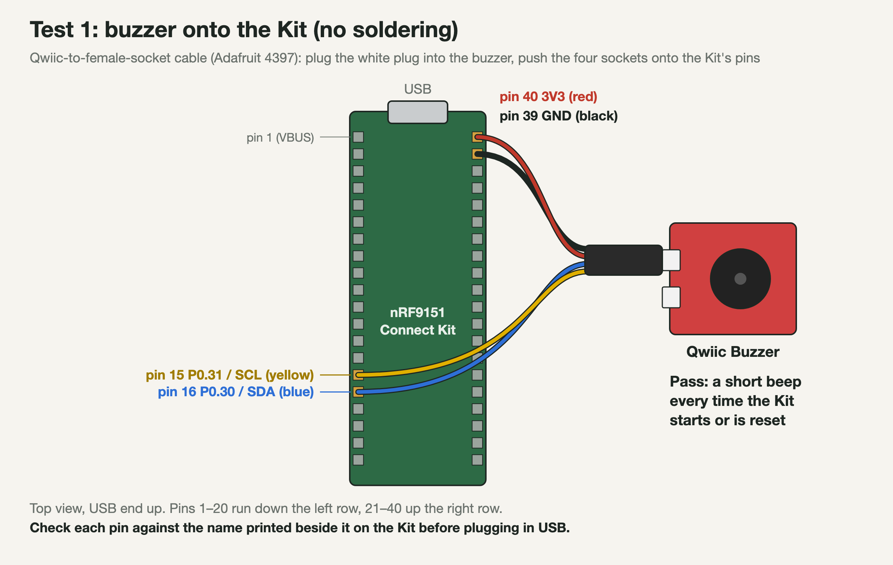
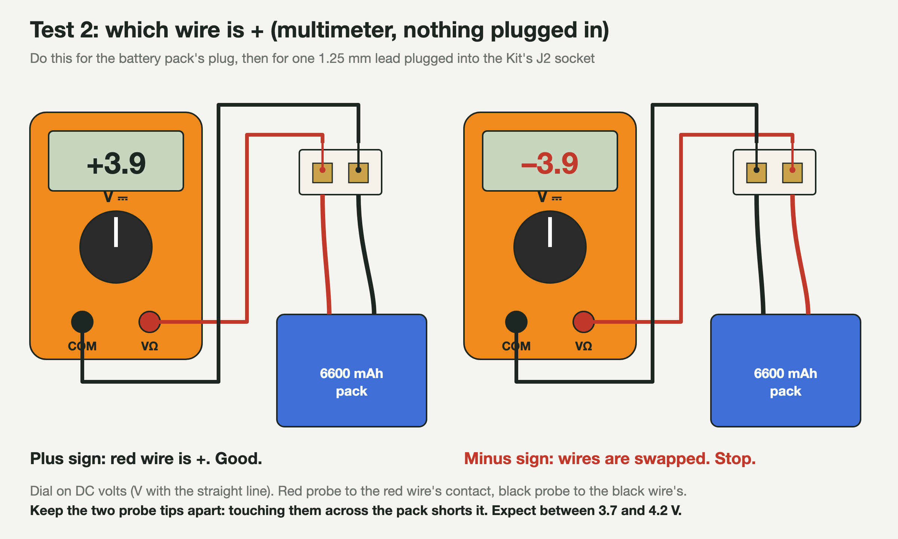
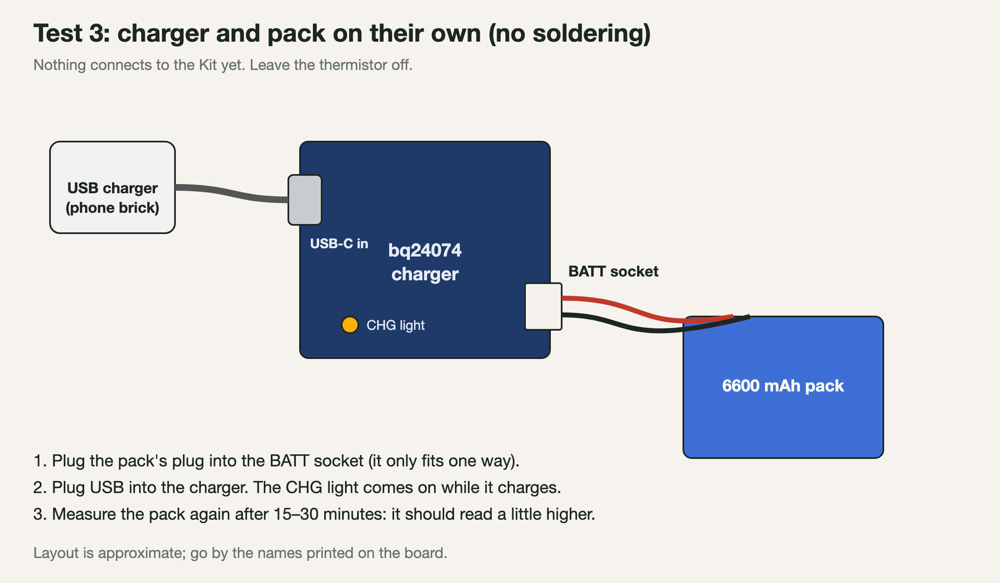
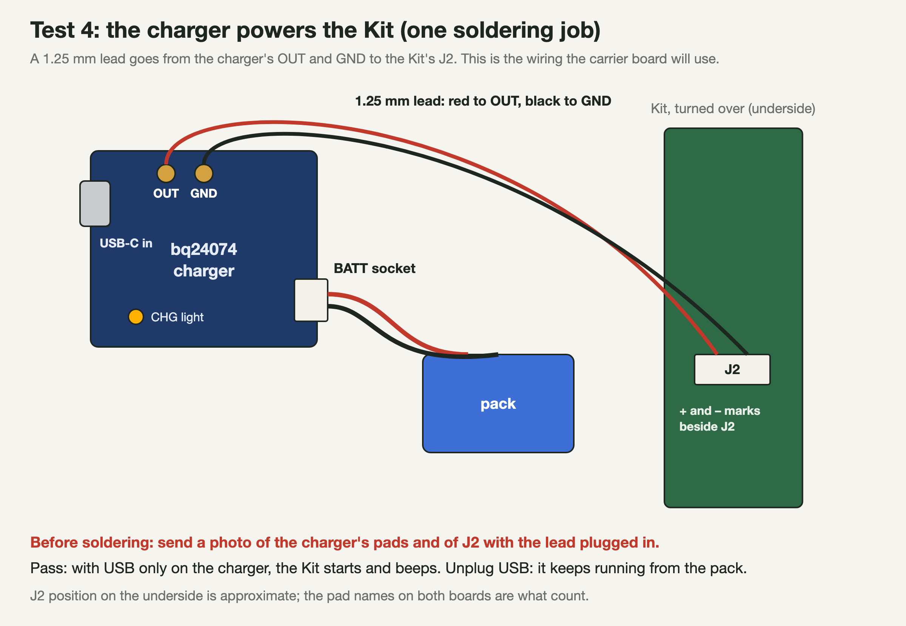
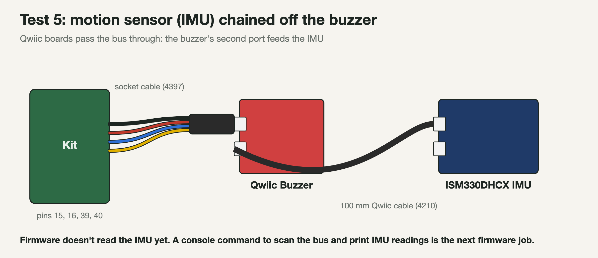

# Bench tests, part by part

Test each part on the bench before anything goes into a shell. Leave each part connected once it passes. Diagrams are drawn by `docs/images/bench/diagrams.py`; the Kit's pin positions come from `hardware/carrier/SPEC.md` section 2.

## 1. Buzzer (no soldering)

Plug the Qwiic-to-socket cable (4397) into the buzzer and push its four sockets onto the Kit's pins: black to pin 39 (GND), red to pin 40 (3V3), blue to pin 16 (P0.30, SDA), yellow to pin 15 (P0.31, SCL). Plug the Kit into USB. The firmware plays a 150 ms beep at start-up when it finds the buzzer.

**Pass:** a beep at every start or reset.

## 2. Which wire is +

Measure the pack's plug, then a 1.25 mm lead plugged into the Kit's J2 (Kit unplugged). Plug colours aren't a standard, so measure before connecting anything.

**Pass:** a positive reading between 3.7 and 4.2 V with the red probe on the red wire.

## 3. Charger and pack (no soldering)

**Pass:** the CHG light comes on with USB in, and the pack reads higher after 15–30 minutes.

## 4. Charger powers the Kit (one soldering job)

The same feed the carrier uses (SPEC.md, "Kit power"): charger OUT to the Kit's J2, so the Kit runs from USB or sun, and from the pack when neither is there. Photo of both ends before soldering.

**Pass:** the Kit starts with USB only on the charger, and keeps running when USB is unplugged.

## 5. Motion sensor

**Pass:** waits on a firmware console command that scans the bus and prints IMU readings.

## Waiting on parts

- MAX-M10S GNSS and the M6 vent (DigiKey).
- Solar panels and SIM tests once those are confirmed in hand.
