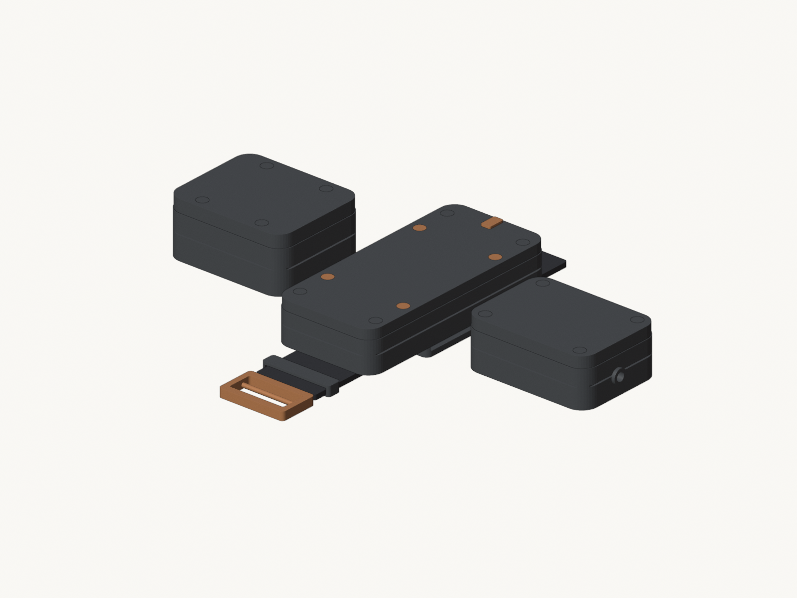
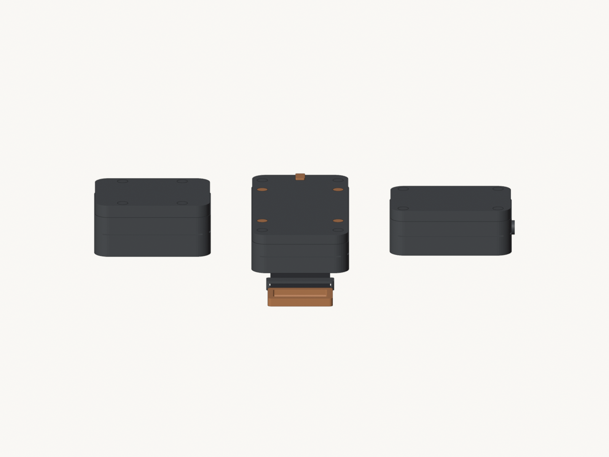
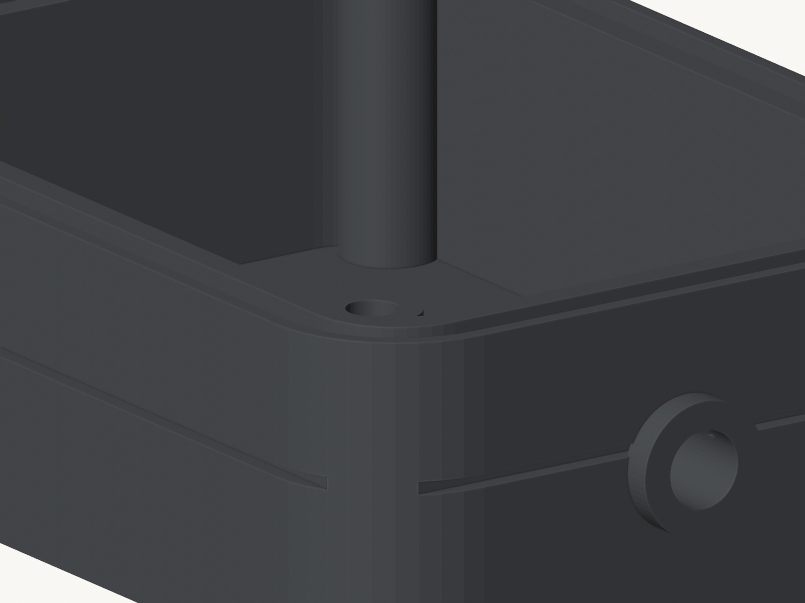
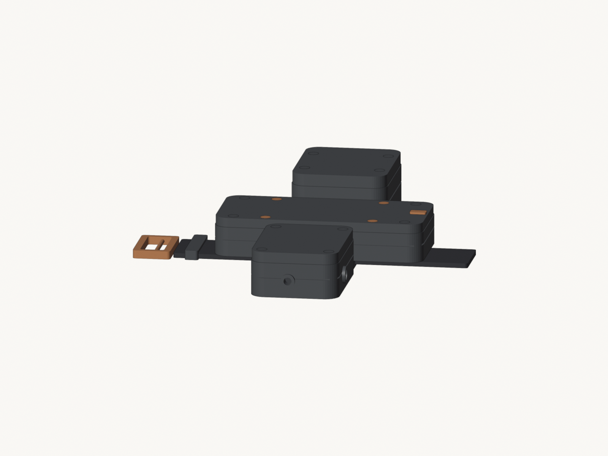
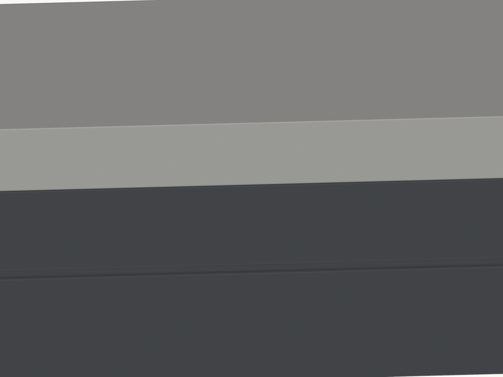
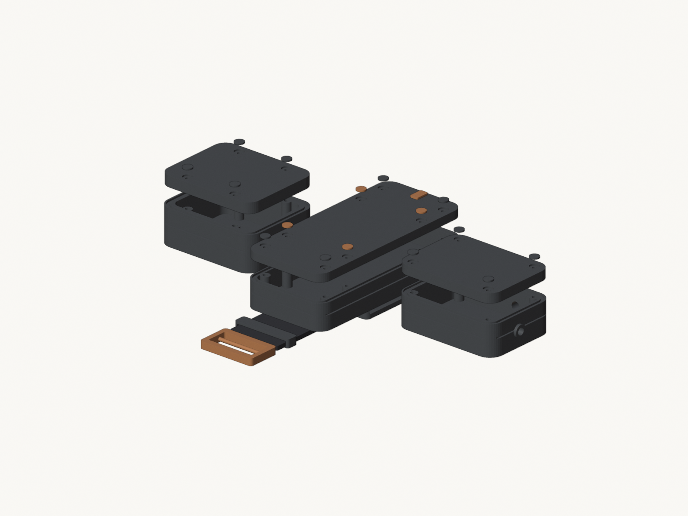
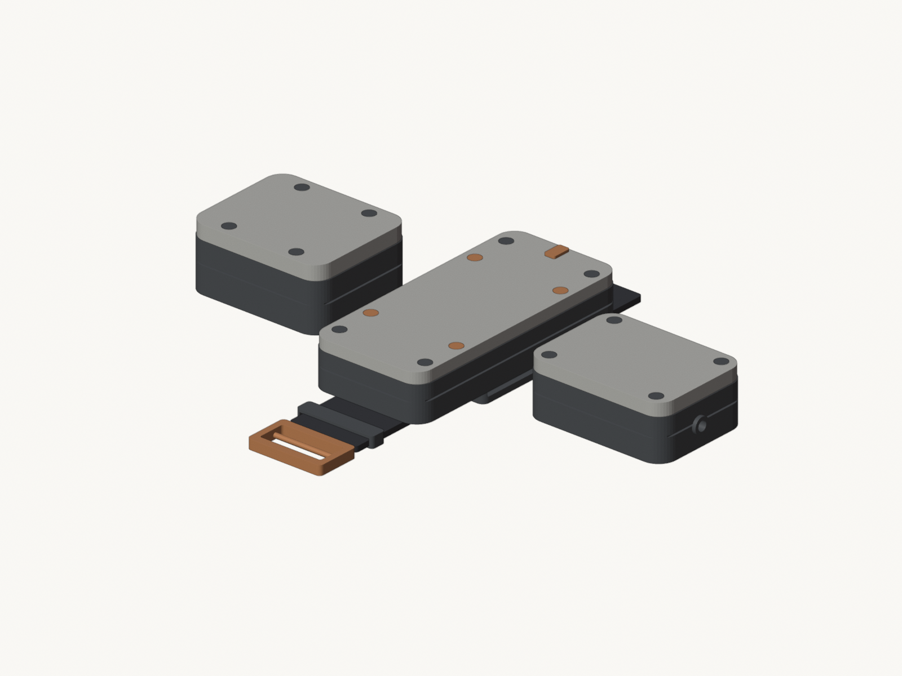

# Rook enclosure concepts

Design studies for the Rook collar housings. Same internal hardware envelope as
Node V1 so the current electronics, cells, and strap clamps still fit. **Not**
drop-in replacements for `stl/node_v1_*`.

## D — Hybrid (D3 look, current)

op-brand direction, **look-first** iteration. Slim-tall soft-radius cap, clean
flat lid tops, visible inset seam, strap saddle/keeper/buckle, orange =
open/replace only. Not print-ready — design study.

| | |
| --- | --- |
| Notes | [`D-hybrid.md`](D-hybrid.md) |
| STLs | [`stl/D_hybrid/`](stl/D_hybrid/) |
| Builder | [`cad/build_concept_d.py`](cad/build_concept_d.py) |



| Assembled | Detail |
| --- | --- |
|  |  |
|  |  |
|  |  |

## Prior studies (A / B / C)

Organic / technical / minimal shells live on PR
[#17](https://github.com/open-pasture/opencollar/pull/17)
(`cursor/rook-enclosure-concepts-9a36`). D supersedes them as the working
direction.

## Envelope (locked)

| Module | Constraint |
| --- | --- |
| Cap | Footprint **76×160**; columns `(±29.5, ±68/±42)`; clamp `(±20, ±28.5)`; cavity height ≥13 mm |
| Pod | Cavity **82×58×21.5**; columns `(±37, ±27)`; outer ~92×68 |
| Counterweight | Outer ~**88×74×30**; lid screws `(±22, ±31.5)`; clamp `(±36, ±29.5)` |

## Print

Bambu P2S concept plate later — **Cody approves any print.** Each shell prints
outside / bed face down, cavity up; no supports on visible faces. Watertight +
footprint checks run in the concept builder.

```sh
cd hardware/rook/concepts/cad
blender --background --factory-startup --python build_concept_d.py
# Colour heroes land in images/ (tracked). Working views under renders/ (gitignored).
```
