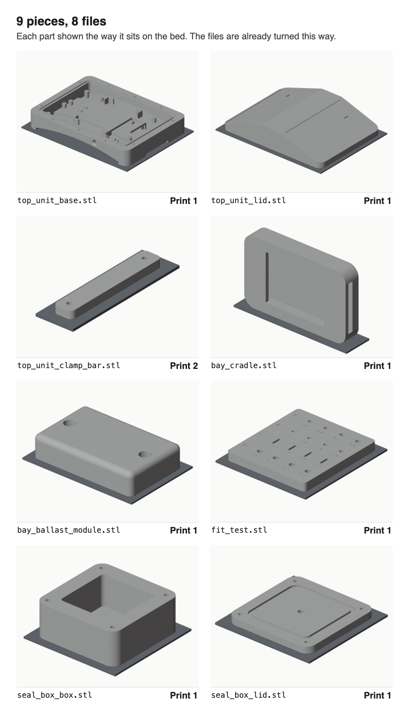

# Print job: 9 plastic parts

Thanks for printing these. They're parts for a prototype cattle collar, but you don't need to know anything about it. Print the files in the `stl` folder, box them up and mail them to me. That's the whole job.

## 1. Print

| | |
| --- | --- |
| Material | **ASA, white or light grey** |
| No ASA? | PA12 nylon on an MJF or SLS machine. Skip the settings below |
| Don't use | PLA, PETG, resin or carbon fibre |
| Layer height | 0.2 mm |
| Walls | 6 |
| Infill | 40 % |
| Supports | Tree supports, wherever your slicer needs them |

- Print every part in the same material on the same printer.
- Don't rotate the files. They're already the right way up, as in the picture.
- The biggest part is 170 × 126 × 31 mm.
- If a part fails, print it again. If it keeps failing, send the rest with a note saying what went wrong.

## 2. Clean up

- Take off all the supports.
- Leave every hole exactly as it came off the printer: no drilling, sanding or tapping, and no inserts. I measure the holes as printed.

## 3. Box it and mail it

- [ ] `top_unit_base`
- [ ] `top_unit_lid`
- [ ] `top_unit_clamp_bar` (2 of them)
- [ ] `bay_cradle`
- [ ] `bay_ballast_module`
- [ ] `fit_test`
- [ ] `seal_box_box`
- [ ] `seal_box_lid`

Wrap the parts so they don't rub against each other. Put a note in the box with the printer and material you used (brand and colour).

Mail to:

> Cody Menefee 
> **[Cody: add your mailing address]**

Send the tracking number to **[Cody: add your phone or email]**.

Thank you!
